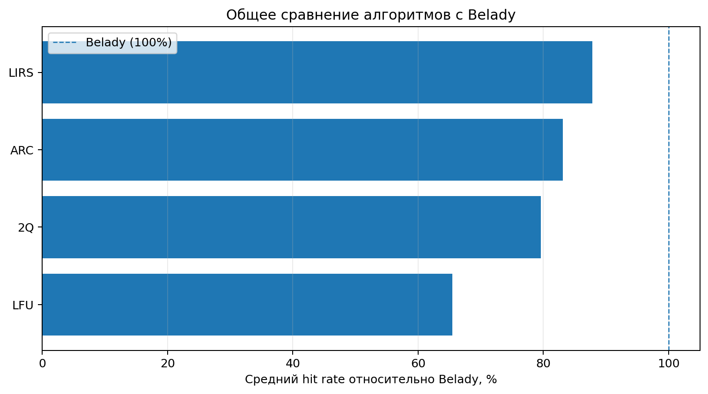

# Отчёт по экспериментам NHWC

## Как читать основную метрику

`belady_ratio` рассчитывается как `hit_rate алгоритма / hit_rate Belady`.
В отчёте он представлен в процентах: 100% означает равный hit rate с Belady;
значение ниже 100% показывает относительное отставание.
`gap_pp` — разница hit rate в процентных пунктах: `hit_rate Belady - hit_rate алгоритма`.
Это разные показатели: первый относительный, второй абсолютный.

Belady используется как офлайн-ориентир только при одинаковой последовательности запросов
и одинаковой ёмкости. Значение ratio не следует трактовать как доказательство оптимальности
реализаций на любых других последовательностях.

## Общий рейтинг относительно Belady

| Алгоритм | Средний hit rate относительно Belady | Среднее отставание, % | Запусков |
|---|---:|---:|---:|
| LIRS | 87.80% | 12.20% | 172 |
| ARC | 83.14% | 16.86% | 172 |
| 2Q | 79.63% | 20.37% | 172 |
| LFU | 65.50% | 34.50% | 172 |

## Лучший алгоритм для каждого шаблона и ёмкости

| Шаблон | Ёмкость | Алгоритм | Относительно Belady | Разрыв, п.п. |
|---|---:|---|---:|---:|
| AlternatingPhases | 10 | LIRS | 78.74% | 16.926 |
| AlternatingPhases | 50 | LIRS | 80.72% | 16.000 |
| AlternatingPhases | 100 | LIRS | 79.69% | 16.190 |
| AlternatingPhases | 500 | LIRS | 61.36% | 27.364 |
| HotScan | 10 | ARC | 100.00% | 0.000 |
| HotScan | 50 | 2Q | 100.00% | 0.000 |
| HotScan | 100 | 2Q | 100.00% | 0.000 |
| HotScan | 500 | LIRS | 98.76% | 0.404 |
| LfuPollution | 10 | ARC | 99.97% | 0.032 |
| LfuPollution | 50 | ARC | 99.81% | 0.186 |
| LfuPollution | 100 | ARC | 99.67% | 0.320 |
| LfuPollution | 500 | ARC | 98.41% | 1.464 |
| Loop | 10 | LIRS | 75.01% | 18.720 |
| Loop | 50 | LIRS | 76.48% | 19.110 |
| Loop | 100 | LIRS | 77.12% | 18.660 |
| Loop | 500 | LIRS | 77.66% | 17.610 |
| LoopFits | 10 | ARC | 100.00% | 0.000 |
| LoopFits | 50 | ARC | 100.00% | 0.000 |
| LoopFits | 100 | ARC | 100.00% | 0.000 |
| LoopFits | 500 | ARC | 100.00% | 0.000 |
| LruStack | 10 | ARC | 91.92% | 7.356 |
| LruStack | 50 | 2Q | 89.32% | 9.816 |
| LruStack | 100 | 2Q | 90.23% | 9.032 |
| LruStack | 500 | LIRS | 99.97% | 0.026 |
| MultiLoop | 10 | LIRS | 89.11% | 7.440 |
| MultiLoop | 50 | LIRS | 87.91% | 8.270 |
| MultiLoop | 100 | LIRS | 87.82% | 8.250 |
| MultiLoop | 500 | LIRS | 91.76% | 5.250 |
| OneHitWonders | 10 | LIRS | 99.98% | 0.010 |
| OneHitWonders | 50 | LIRS | 99.87% | 0.066 |
| OneHitWonders | 100 | ARC | 99.71% | 0.146 |
| OneHitWonders | 500 | ARC | 98.29% | 0.814 |
| Uniform | 10 | LIRS | 66.31% | 25.522 |
| Uniform | 50 | LFU | 63.40% | 28.820 |
| Uniform | 100 | LFU | 62.80% | 29.346 |
| Uniform | 500 | ARC | 63.84% | 27.490 |
| WorkingSetShift | 10 | ARC | 99.96% | 0.042 |
| WorkingSetShift | 50 | ARC | 99.79% | 0.202 |
| WorkingSetShift | 100 | ARC | 99.63% | 0.354 |
| WorkingSetShift | 500 | ARC | 98.03% | 1.580 |
| Zipf | 10 | LFU | 82.45% | 10.872 |
| Zipf | 50 | LFU | 85.47% | 10.468 |
| Zipf | 100 | LFU | 86.46% | 10.082 |
| Zipf | 500 | LFU | 88.78% | 8.450 |

## Основные графики

### Общее сравнение

Графики по каждому шаблону и тепловые карты находятся в каталоге `figures/`.

## Двухуровневый кэш

Таблица `two_level_by_pattern.csv` содержит сводку конфигураций,
а `two_level_best_by_pattern.csv` — лучшую конфигурацию для каждого шаблона и общей ёмкости.
Лучшие конфигурации выбираются по среднему `belady_ratio`.

| Шаблон | Общая ёмкость | L1/L2 алгоритмы | Режим | Относительно Belady |
|---|---:|---|---|---:|
| AlternatingPhases | 10 | ARC/LIRS | fill_l2_only | 67.53% |
| AlternatingPhases | 50 | LIRS/LIRS | fill_l2_only | 69.04% |
| AlternatingPhases | 100 | LIRS/LIRS | fill_both | 69.14% |
| AlternatingPhases | 500 | LFU/LIRS | fill_l2_only | 63.47% |
| HotScan | 10 | 2Q/LFU | fill_l2_only | 100.00% |
| HotScan | 50 | LIRS/ARC | fill_l2_only | 100.00% |
| HotScan | 100 | ARC/LIRS | fill_both | 100.00% |
| HotScan | 500 | ARC/LIRS | fill_both | 99.73% |
| LfuPollution | 10 | ARC/ARC | fill_l2_only | 99.97% |
| LfuPollution | 50 | LFU/ARC | fill_both | 99.83% |
| LfuPollution | 100 | LFU/ARC | fill_both | 99.67% |
| LfuPollution | 500 | LIRS/ARC | fill_l2_only | 98.39% |
| Loop | 10 | LFU/LIRS | fill_l2_only | 72.94% |
| Loop | 50 | LFU/LIRS | fill_l2_only | 80.35% |
| Loop | 100 | LFU/LIRS | fill_l2_only | 78.34% |
| Loop | 500 | LFU/LIRS | fill_l2_only | 77.05% |
| LoopFits | 10 | LFU/LIRS | fill_l2_only | 74.25% |
| LoopFits | 50 | LFU/LIRS | fill_l2_only | 88.61% |
| LoopFits | 100 | LFU/LIRS | fill_l2_only | 85.91% |
| LoopFits | 500 | LFU/LIRS | fill_l2_only | 84.21% |
| LruStack | 10 | LFU/ARC | fill_l2_only | 85.97% |
| LruStack | 50 | LFU/2Q | fill_l2_only | 85.13% |
| LruStack | 100 | LFU/2Q | fill_both | 88.27% |
| LruStack | 500 | LFU/LFU | fill_both | 99.93% |
| MultiLoop | 10 | LFU/LIRS | fill_l2_only | 85.94% |
| MultiLoop | 50 | LFU/LIRS | fill_l2_only | 87.99% |
| MultiLoop | 100 | LFU/LIRS | fill_l2_only | 90.04% |
| MultiLoop | 500 | ARC/LIRS | fill_l2_only | 90.20% |
| OneHitWonders | 10 | LFU/LIRS | fill_both | 99.99% |
| OneHitWonders | 50 | LFU/LIRS | fill_both | 99.84% |
| OneHitWonders | 100 | LFU/LIRS | fill_both | 99.70% |
| OneHitWonders | 500 | LFU/ARC | fill_both | 97.78% |
| Uniform | 10 | LFU/ARC | fill_l2_only | 60.25% |
| Uniform | 50 | LFU/ARC | fill_both | 61.70% |
| Uniform | 100 | LFU/LIRS | fill_l2_only | 61.83% |
| Uniform | 500 | LFU/ARC | fill_both | 62.66% |
| WorkingSetShift | 10 | LIRS/ARC | fill_l2_only | 99.96% |
| WorkingSetShift | 50 | LFU/ARC | fill_both | 99.80% |
| WorkingSetShift | 100 | 2Q/ARC | fill_l2_only | 99.62% |
| WorkingSetShift | 500 | 2Q/ARC | fill_l2_only | 97.88% |
| Zipf | 10 | LFU/LFU | fill_l2_only | 78.55% |
| Zipf | 50 | LFU/ARC | fill_l2_only | 85.45% |
| Zipf | 100 | LFU/ARC | fill_l2_only | 86.50% |
| Zipf | 500 | LFU/LIRS | fill_l2_only | 87.79% |

## Время выполнения

Тайминги приведены как дополнительная характеристика и не используются для
определения близости к Belady. Подробные замеры находятся в `time_results.csv`.

## Ограничения интерпретации

- Средние значения объединяют разные шаблоны и ёмкости; для выводов по конкретной нагрузке смотрите отдельные таблицы и графики.
- Для случайных шаблонов стандартное отклонение отражает вариативность между seed.
- Если hit rate Belady равен нулю, C++-функция записывает `belady_ratio = 1.0`; такие строки требуют отдельной осторожности при интерпретации.
- Belady — офлайн-эталон: он знает будущую последовательность запросов, в отличие от онлайн-алгоритмов.
